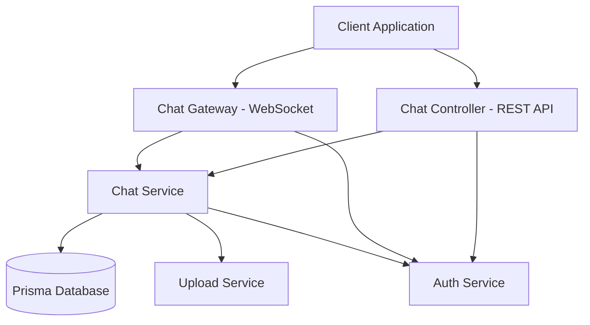

# Chat Module Design Document

## Overview

The chat module will implement a real-time messaging system for the furniture marketplace platform, enabling communication between users and administrators. The system will leverage WebSocket connections for real-time messaging, REST APIs for message history and conversation management, and integrate with the existing authentication and file upload systems.

The design follows NestJS architectural patterns with a dedicated chat module containing controllers, services, gateways, and DTOs. The module will integrate with the existing Prisma database models (Conversation, Message) and utilize the current authentication guards and file upload infrastructure.

## Architecture

### High-Level Architecture



### Module Structure

The chat module will follow the established NestJS pattern:

```
src/chat/
├── chat.module.ts           # Module definition with imports/exports
├── chat.controller.ts       # REST API endpoints
├── chat.service.ts          # Business logic and database operations
├── chat.gateway.ts          # WebSocket gateway for real-time messaging
├── dto/                     # Data Transfer Objects
│   ├── create-message.dto.ts
│   ├── conversation-query.dto.ts
│   └── message-response.dto.ts
├── entities/                # Response entities
│   ├── conversation.entity.ts
│   └── message.entity.ts
└── guards/                  # WebSocket authentication guards
    └── ws-jwt.guard.ts
```

## Components and Interfaces

### 1. Chat Controller (REST API)

**Endpoints:**
- `GET /conversations` - List user's conversations
- `GET /conversations/:id` - Get specific conversation details
- `GET /conversations/:id/messages` - Get conversation message history
- `POST /conversations/:id/messages` - Send a new message
- `POST /conversations/:id/upload` - Upload file attachment
- `PATCH /conversations/:id/read` - Mark messages as read
- `PATCH /conversations/:id/archive` - Archive conversation (admin only)

**Authentication:** JWT Bearer token required for all endpoints
**Authorization:** Users can only access their own conversations; admins can access all

### 2. Chat Gateway (WebSocket)

**Events:**
- `join-conversation` - Join a conversation room
- `leave-conversation` - Leave a conversation room  
- `send-message` - Send real-time message
- `message-received` - Broadcast new message to participants
- `typing-start` - Indicate user is typing
- `typing-stop` - Indicate user stopped typing
- `message-read` - Broadcast read receipt

**Authentication:** JWT token validation on connection
**Rooms:** Each conversation has its own room identified by conversation ID

### 3. Chat Service

**Core Methods:**
```typescript
// Conversation Management
findUserConversations(userId: number): Promise<Conversation[]>
findOrCreateConversation(userId: number, adminId: number): Promise<Conversation>
getConversationById(id: number, userId: number): Promise<Conversation>
archiveConversation(id: number, adminId: number): Promise<void>

// Message Operations
getConversationMessages(conversationId: number, userId: number): Promise<Message[]>
createMessage(conversationId: number, senderId: number, content: string, type?: MessageType): Promise<Message>
createImageMessage(conversationId: number, senderId: number, imageUrl: string): Promise<Message>
markMessagesAsRead(conversationId: number, userId: number): Promise<void>

// Admin Operations
getAllConversations(): Promise<Conversation[]>
getConversationStats(): Promise<ConversationStats>
```

### 4. WebSocket Authentication Guard

Custom guard extending `@nestjs/websockets` to validate JWT tokens on WebSocket connections:

```typescript
@Injectable()
export class WsJwtGuard implements CanActivate {
  canActivate(context: ExecutionContext): boolean | Promise<boolean> {
    const client = context.switchToWs().getClient();
    const token = this.extractTokenFromHandshake(client);
    return this.validateToken(token);
  }
}
```

## Data Models

### Conversation Entity (Response)

```typescript
export class ConversationEntity {
  id: number;
  user1Id: number;
  user2Id: number;
  isActive: boolean;
  createdAt: Date;
  updatedAt: Date;
  
  // Populated relations
  user1?: UserEntity;
  user2?: UserEntity;
  lastMessage?: MessageEntity;
  unreadCount?: number;
}
```

### Message Entity (Response)

```typescript
export class MessageEntity {
  id: number;
  conversationId: number;
  senderId: number;
  content: string;
  messageType: MessageType;
  attachmentUrl?: string;
  isRead: boolean;
  readAt?: Date;
  createdAt: Date;
  updatedAt: Date;
  
  // Populated relations
  sender?: UserEntity;
}
```

### DTOs

**CreateMessageDto:**
```typescript
export class CreateMessageDto {
  @IsString()
  @IsNotEmpty()
  content: string;
  
  @IsEnum(MessageType)
  @IsOptional()
  messageType?: MessageType = MessageType.TEXT;
}
```

**ConversationQueryDto:**
```typescript
export class ConversationQueryDto {
  @IsOptional()
  @IsNumber()
  @Transform(({ value }) => parseInt(value))
  page?: number = 1;
  
  @IsOptional()
  @IsNumber()
  @Transform(({ value }) => parseInt(value))
  limit?: number = 20;
  
  @IsOptional()
  @IsBoolean()
  @Transform(({ value }) => value === 'true')
  includeArchived?: boolean = false;
}
```

## Error Handling

### HTTP Exceptions
- `400 Bad Request` - Invalid message content or conversation ID
- `401 Unauthorized` - Missing or invalid JWT token
- `403 Forbidden` - User not participant in conversation
- `404 Not Found` - Conversation or message not found
- `413 Payload Too Large` - File attachment exceeds size limit
- `422 Unprocessable Entity` - Invalid file type for attachment

### WebSocket Exceptions
- `WsException` for WebSocket-specific errors
- Connection termination for authentication failures
- Error events sent to client for invalid operations

### Error Response Format
```typescript
{
  statusCode: number;
  message: string | string[];
  error: string;
  timestamp: string;
  path: string;
}
```

## Testing Strategy

### Unit Tests

**Chat Service Tests:**
- Conversation creation and retrieval
- Message creation with different types
- Permission validation
- Read status updates
- Archive functionality

**Chat Controller Tests:**
- Endpoint authentication and authorization
- Request/response validation
- Error handling scenarios
- File upload integration

**Chat Gateway Tests:**
- WebSocket connection handling
- Event emission and reception
- Room management
- Authentication guard integration

### Integration Tests

**Database Integration:**
- Prisma model interactions
- Transaction handling
- Constraint validation
- Cascade operations

**WebSocket Integration:**
- Real-time message delivery
- Multiple client connections
- Room isolation
- Connection lifecycle

### E2E Tests

**Complete User Flows:**
- User initiates conversation with admin
- Send and receive messages
- File attachment upload and sharing
- Message read receipts
- Conversation archiving

**Admin Workflows:**
- View all conversations
- Respond to user messages
- Archive conversations
- Bulk operations

## Security Considerations

### Authentication & Authorization
- JWT token validation for both REST and WebSocket connections
- User can only access conversations they participate in
- Admin role required for administrative operations
- Rate limiting on message sending

### Input Validation & Sanitization
- Message content sanitization to prevent XSS
- File type validation for attachments
- File size limits (5MB for images)
- Malicious file scanning for uploads

### Data Privacy
- Conversation isolation between users
- Message encryption in transit (HTTPS/WSS)
- Audit logging for admin actions
- GDPR compliance for message deletion

## Performance Optimizations

### Database Queries
- Indexed queries on conversation participants
- Pagination for message history
- Efficient unread count calculations
- Connection pooling optimization

### WebSocket Management
- Connection cleanup on disconnect
- Room-based message broadcasting
- Memory-efficient client tracking
- Heartbeat mechanism for connection health

### Caching Strategy
- Redis caching for active conversations
- Message history caching for frequently accessed conversations
- User online status caching
- Rate limiting cache for spam prevention

## Integration Points

### Existing Services
- **AuthService**: User authentication and role validation
- **UploadService**: File attachment handling
- **UsersService**: User information retrieval
- **DatabaseService**: Prisma client access

### External Dependencies
- **@nestjs/websockets**: WebSocket gateway implementation
- **socket.io**: Real-time communication protocol
- **@nestjs/platform-socket.io**: NestJS Socket.io adapter
- **multer**: File upload middleware (already available)

### Configuration Requirements
```typescript
// Environment variables
CHAT_MAX_MESSAGE_LENGTH=1000
CHAT_MAX_FILE_SIZE=5242880  // 5MB
CHAT_ALLOWED_FILE_TYPES=jpg,jpeg,png,gif
REDIS_URL=redis://localhost:6379  // For caching (optional)
```

## Deployment Considerations

### WebSocket Support
- Load balancer configuration for WebSocket sticky sessions
- Redis adapter for multi-instance Socket.io scaling
- Proper CORS configuration for WebSocket connections

### Monitoring & Logging
- WebSocket connection metrics
- Message delivery success rates
- Error rate monitoring
- Performance metrics for real-time features

### Scalability
- Horizontal scaling with Redis adapter
- Database connection pooling
- CDN integration for file attachments
- Message archiving strategy for long-term storage