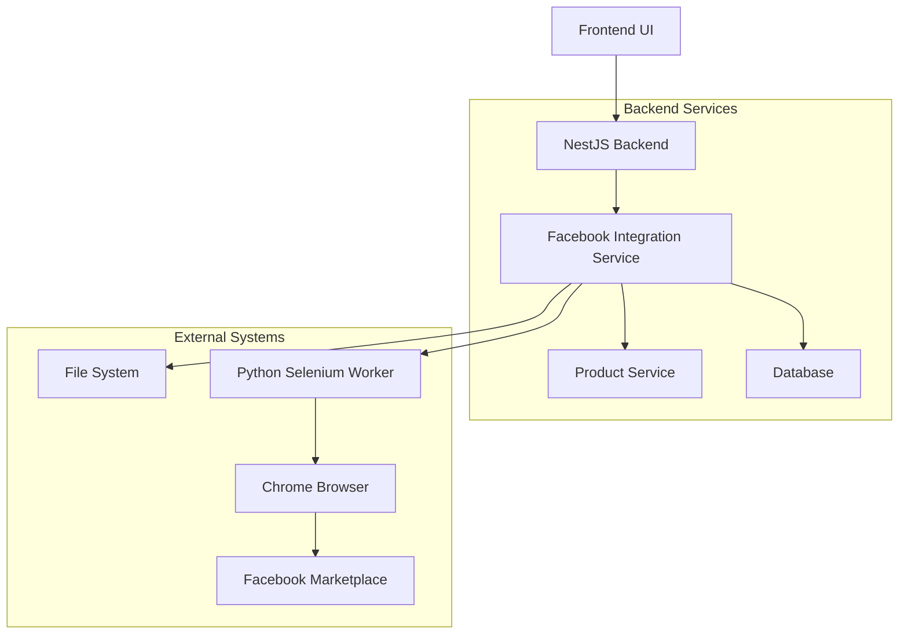

# Design Document

## Overview

The Facebook Marketplace Automation feature enables users to automatically publish their furniture marketplace products to Facebook Marketplace through Selenium-based browser automation. The system consists of a NestJS backend integration, a Python Selenium worker, and database extensions to track Facebook posting status.

## Architecture

### High-Level Flow
1. User clicks "Post to Facebook" button in the frontend
2. Frontend calls POST `/api/v1/integrations/facebook/publish?productId={id}`
3. Backend loads product data and creates temporary JSON file
4. Backend spawns Python Selenium worker process
5. Selenium worker launches Chrome with logged-in Facebook profile
6. Worker navigates to Facebook Marketplace and fills form automatically
7. Worker publishes listing and returns status
8. Backend updates database with posting status and cleans up

### System Components



## Components and Interfaces

### 1. Database Schema Extensions

Add Facebook posting tracking to the Product model:

```prisma
model Product {
  // ... existing fields
  facebookPostingStatus FacebookPostingStatus @default(NOT_POSTED) @map("facebook_posting_status")
  facebookListingUrl    String?                                     @map("facebook_listing_url")
  facebookPostedAt      DateTime?                                   @map("facebook_posted_at")
  facebookLastError     String?                                     @map("facebook_last_error")
  facebookRetryCount    Int                      @default(0)        @map("facebook_retry_count")
}

enum FacebookPostingStatus {
  NOT_POSTED
  POSTING
  POSTED
  FAILED
  NEEDS_UPDATE
}
```

### 2. Facebook Integration Module

**FacebookIntegrationModule**
- Imports: ProductsModule, ConfigModule
- Controllers: FacebookIntegrationController
- Services: FacebookIntegrationService, SeleniumWorkerService
- Providers: Configuration for Selenium paths and settings

**FacebookIntegrationService**
```typescript
interface FacebookIntegrationService {
  publishToFacebook(productId: number, userId: number): Promise<FacebookPublishResult>
  getPublishingStatus(productId: number): Promise<FacebookPostingStatus>
  retryFailedPublishing(productId: number, userId: number): Promise<FacebookPublishResult>
  updateProductPostingStatus(productId: number, status: FacebookPostingStatus, error?: string): Promise<void>
}

interface FacebookPublishResult {
  success: boolean
  status: FacebookPostingStatus
  listingUrl?: string
  error?: string
}
```

**SeleniumWorkerService**
```typescript
interface SeleniumWorkerService {
  executeSeleniumScript(productData: FacebookProductData, tempFilePath: string): Promise<SeleniumResult>
  createTempProductFile(productData: FacebookProductData): Promise<string>
  cleanupTempFile(filePath: string): Promise<void>
  validateSeleniumEnvironment(): Promise<boolean>
}

interface SeleniumResult {
  success: boolean
  listingUrl?: string
  error?: string
  screenshot?: string
}
```

### 3. Data Transfer Objects

**FacebookProductData**
```typescript
interface FacebookProductData {
  title: string
  description: string
  price: string
  category: string
  condition: string
  images: string[]
  tags: string[]
  sku?: string
  meetupPreference: string
  inStock: boolean
}
```

**PublishToFacebookDto**
```typescript
class PublishToFacebookDto {
  @IsOptional()
  @IsString()
  meetupPreference?: string = 'Door drop-off'
  
  @IsOptional()
  @IsBoolean()
  overrideExisting?: boolean = false
}
```

### 4. Python Selenium Worker

**File Structure:**
```
scripts/
├── facebook_automation/
│   ├── __init__.py
│   ├── fb_publisher.py          # Main Selenium script
│   ├── config.py                # Configuration management
│   ├── selectors.py             # Facebook element selectors
│   ├── utils.py                 # Helper functions
│   └── requirements.txt         # Python dependencies
```

**Core Selenium Functions:**
- `make_driver()` - Initialize Chrome with Facebook profile
- `upload_photos()` - Handle image uploads
- `fill_basic_fields()` - Fill title, description, price
- `select_category_and_condition()` - Handle dropdown selections
- `add_product_tags()` - Add tags to listing
- `set_meetup_preferences()` - Configure delivery options
- `publish_listing()` - Submit the form
- `extract_listing_url()` - Get the published listing URL

### 5. Configuration Management

**Environment Variables:**
```env
# Facebook Automation Settings
FACEBOOK_CHROME_USER_DATA_DIR=C:\Users\User\AppData\Local\Google\Chrome\User Data
FACEBOOK_CHROME_PROFILE=Default
FACEBOOK_SELENIUM_TIMEOUT=60
FACEBOOK_TEMP_FILES_DIR=/tmp/facebook_automation
FACEBOOK_PYTHON_SCRIPT_PATH=./scripts/facebook_automation/fb_publisher.py
FACEBOOK_MAX_RETRY_ATTEMPTS=3
FACEBOOK_CLEANUP_TEMP_FILES=true
```

**Configuration Service:**
```typescript
interface FacebookConfig {
  chromeUserDataDir: string
  chromeProfile: string
  seleniumTimeout: number
  tempFilesDir: string
  pythonScriptPath: string
  maxRetryAttempts: number
  cleanupTempFiles: boolean
}
```

## Data Models

### Product Category Mapping

Map internal categories to Facebook categories:
```typescript
const FACEBOOK_CATEGORY_MAPPING = {
  'BEDS': 'Home & Garden',
  'CHAIRS': 'Home & Garden', 
  'TABLES': 'Home & Garden',
  'SOFAS': 'Home & Garden',
  'WARDROBES': 'Home & Garden',
  'DINING_SETS': 'Home & Garden',
  'OFFICE_FURNITURE': 'Home & Garden',
  'DECORATIVE_ITEMS': 'Home & Garden',
  'LIGHTING': 'Home & Garden',
  'STORAGE': 'Home & Garden',
  'DRESSER': 'Home & Garden',
  'OTHER': 'Home & Garden'
}
```

### Condition Mapping

Map internal conditions to Facebook conditions:
```typescript
const FACEBOOK_CONDITION_MAPPING = {
  'NEW': 'New',
  'LIKE_NEW': 'Like New',
  'GOOD': 'Good',
  'FAIR': 'Fair',
  'SECOND_HAND': 'Used'
}
```

### Image Path Resolution

Convert Cloudinary URLs to local file paths for Selenium:
```typescript
interface ImagePathResolver {
  downloadCloudinaryImage(url: string): Promise<string>
  getLocalImagePath(cloudinaryUrl: string): Promise<string>
  cleanupDownloadedImages(paths: string[]): Promise<void>
}
```

## Error Handling

### Error Categories

1. **Configuration Errors**
   - Missing Chrome profile
   - Invalid Python script path
   - Missing environment variables

2. **Authentication Errors**
   - Facebook not logged in
   - Session expired
   - Two-factor authentication required

3. **Selenium Errors**
   - Element not found
   - Timeout waiting for page load
   - Chrome driver issues

4. **Facebook Platform Errors**
   - Captcha challenges
   - Rate limiting
   - Policy violations
   - Required fields missing

5. **File System Errors**
   - Image download failures
   - Temporary file creation issues
   - Permission problems

### Error Handling Strategy

```typescript
class FacebookAutomationError extends Error {
  constructor(
    message: string,
    public readonly category: ErrorCategory,
    public readonly retryable: boolean = false,
    public readonly screenshot?: string
  ) {
    super(message)
  }
}

enum ErrorCategory {
  CONFIGURATION = 'configuration',
  AUTHENTICATION = 'authentication', 
  SELENIUM = 'selenium',
  FACEBOOK_PLATFORM = 'facebook_platform',
  FILE_SYSTEM = 'file_system'
}
```

### Retry Logic

```typescript
interface RetryConfig {
  maxAttempts: number
  backoffMultiplier: number
  retryableErrors: ErrorCategory[]
}

const DEFAULT_RETRY_CONFIG: RetryConfig = {
  maxAttempts: 3,
  backoffMultiplier: 2,
  retryableErrors: [
    ErrorCategory.SELENIUM,
    ErrorCategory.FILE_SYSTEM
  ]
}
```

## Testing Strategy

### Unit Tests

1. **FacebookIntegrationService Tests**
   - Product data transformation
   - Status updates
   - Error handling

2. **SeleniumWorkerService Tests**
   - Temp file creation/cleanup
   - Process spawning
   - Configuration validation

3. **Data Mapping Tests**
   - Category mapping accuracy
   - Condition mapping accuracy
   - Image path resolution

### Integration Tests

1. **End-to-End Flow Tests**
   - Mock Selenium worker responses
   - Database state changes
   - File system operations

2. **Error Scenario Tests**
   - Failed Selenium execution
   - Invalid product data
   - Missing configuration

### Manual Testing

1. **Selenium Script Testing**
   - Facebook login verification
   - Form filling accuracy
   - Image upload functionality
   - Publishing success

2. **Browser Compatibility**
   - Chrome version compatibility
   - Profile persistence
   - Headless mode testing

## Security Considerations

### Data Protection
- Temporary files contain sensitive product data
- Implement secure file cleanup
- Use appropriate file permissions

### Facebook Account Security
- Store Chrome profile securely
- Monitor for suspicious activity
- Implement session validation

### Rate Limiting
- Respect Facebook's rate limits
- Implement delays between requests
- Monitor for blocking/captchas

### Error Information
- Sanitize error messages in logs
- Avoid exposing sensitive paths
- Secure screenshot storage

## Performance Considerations

### Selenium Optimization
- Reuse Chrome instances when possible
- Implement connection pooling
- Use headless mode for production

### File System Management
- Efficient image downloading
- Parallel image processing
- Automatic cleanup scheduling

### Database Performance
- Index Facebook posting status fields
- Batch status updates
- Optimize retry queries

### Scalability
- Queue-based processing for multiple requests
- Worker process management
- Resource usage monitoring

## Monitoring and Logging

### Metrics to Track
- Publishing success rate
- Average processing time
- Error frequency by category
- Retry attempt statistics

### Logging Strategy
```typescript
interface FacebookAutomationLog {
  productId: number
  userId: number
  action: string
  status: 'started' | 'completed' | 'failed'
  duration?: number
  error?: string
  screenshot?: string
  timestamp: Date
}
```

### Health Checks
- Selenium environment validation
- Chrome profile accessibility
- Python script availability
- Facebook login status verification