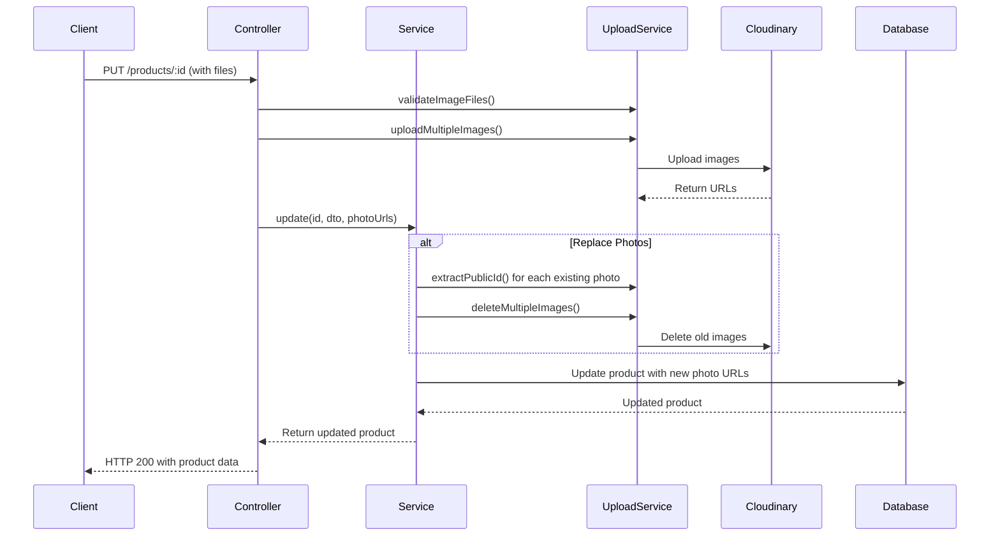
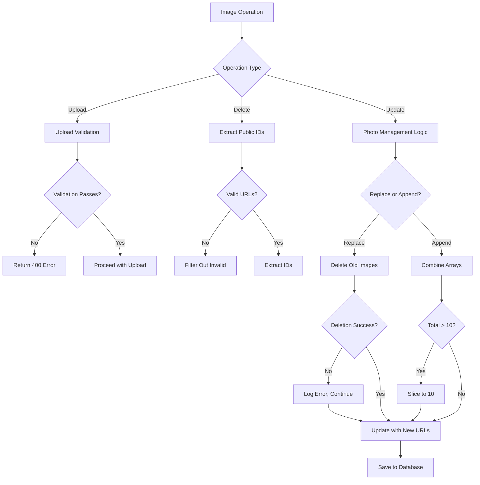

# Design Document

## Overview

This design document outlines the implementation approach for comprehensive product image management, focusing on type-safe operations, proper error handling, and seamless integration with the existing Cloudinary-based upload system. The solution addresses TypeScript type safety issues while maintaining robust image lifecycle management.

## Architecture

### Component Interaction Flow



### Error Handling Flow



## Components and Interfaces

### Enhanced UploadService Interface

The UploadService needs type-safe methods for URL processing and batch operations:

```typescript
interface UploadService {
  // Existing methods
  uploadImage(file: Express.Multer.File, folder?: string): Promise<CloudinaryResponse>;
  uploadMultipleImages(files: Express.Multer.File[], folder?: string): Promise<CloudinaryResponse[]>;
  deleteImage(publicId: string): Promise<void>;
  validateImageFile(file: Express.Multer.File): void;
  validateImageFiles(files: Express.Multer.File[]): void;
  
  // Enhanced methods for type safety
  extractPublicId(cloudinaryUrl: string): string | null;
  deleteMultipleImages(publicIds: string[]): Promise<void>;
  extractPublicIds(urls: string[]): string[];
}
```

### ProductsService Interface Enhancement

```typescript
interface ProductsService {
  update(
    id: number,
    userId: number,
    updateProductDto: UpdateProductDto,
    newPhotoUrls?: string[]
  ): Promise<ProductWithOwner>;
  
  remove(id: number, userId: number, userRole: string): Promise<void>;
}
```

### UpdateProductDto Enhancement

```typescript
class UpdateProductDto extends PartialType(CreateProductDto) {
  replacePhotos?: boolean; // Controls photo replacement behavior
}
```

## Data Models

### Photo Management Data Flow

```typescript
interface PhotoUpdateOperation {
  existingPhotos: string[];
  newPhotos: string[];
  replaceMode: boolean;
  finalPhotos: string[];
  deletedPublicIds: string[];
}
```

### Error Response Models

```typescript
interface ImageOperationError {
  operation: 'upload' | 'delete' | 'extract';
  message: string;
  details?: any;
  recoverable: boolean;
}
```

## Error Handling

### Type Safety Strategy

1. **Null-Safe Public ID Extraction**: The `extractPublicId` method should return `string | null` to handle malformed URLs safely
2. **Array Filtering**: Use proper TypeScript filtering to remove null/undefined values
3. **Error Boundaries**: Wrap Cloudinary operations in try-catch blocks with specific error types

### Error Recovery Patterns

```typescript
// Pattern 1: Graceful degradation for non-critical operations
try {
  await this.uploadService.deleteMultipleImages(publicIds);
} catch (error) {
  console.error('Image deletion failed, continuing with product update:', error);
  // Continue with product update
}

// Pattern 2: Fail-fast for critical operations
try {
  const uploadResults = await this.uploadService.uploadMultipleImages(files);
  photoUrls = uploadResults.map(result => result.secure_url);
} catch (error) {
  throw new BadRequestException('Failed to upload images. Please try again.');
}
```

### Logging Strategy

- **Info Level**: Successful operations, photo counts
- **Warn Level**: Recoverable errors (failed deletions that don't block operations)
- **Error Level**: Critical failures that prevent operations
- **Debug Level**: Detailed operation traces for troubleshooting

## Testing Strategy

### Unit Tests

1. **UploadService Tests**:
   - `extractPublicId()` with valid Cloudinary URLs
   - `extractPublicId()` with malformed URLs
   - `deleteMultipleImages()` with mixed valid/invalid IDs
   - Error handling for Cloudinary API failures

2. **ProductsService Tests**:
   - Photo replacement logic
   - Photo appending with limit enforcement
   - Error recovery during image operations
   - Product deletion with image cleanup

3. **Controller Tests**:
   - File upload validation
   - Multipart form data handling
   - Error response formatting

### Integration Tests

1. **End-to-End Photo Management**:
   - Create product with images
   - Update product replacing images
   - Update product appending images
   - Delete product with image cleanup

2. **Error Scenarios**:
   - Cloudinary service unavailable
   - Invalid image formats
   - Network timeouts during upload/delete

### Type Safety Tests

1. **TypeScript Compilation**: Ensure all image operations compile without type errors
2. **Runtime Type Validation**: Verify proper handling of null/undefined values
3. **API Contract Tests**: Validate request/response types match specifications

## Implementation Phases

### Phase 1: Type Safety Fixes
- Fix `extractPublicId` return type
- Add proper null checking and filtering
- Update method signatures for type safety

### Phase 2: Enhanced Error Handling
- Implement graceful degradation patterns
- Add comprehensive logging
- Create specific error types for image operations

### Phase 3: Feature Completion
- Implement photo replacement logic
- Add photo limit enforcement
- Complete product deletion image cleanup

### Phase 4: Testing and Documentation
- Comprehensive unit and integration tests
- API documentation updates
- Error handling documentation